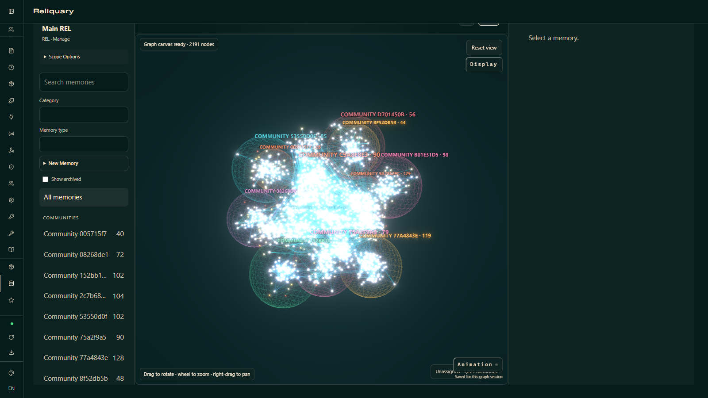

# Reliquary for Hermes

Persistent, inspectable memory for Hermes, with source provenance and a relationship-driven 3D graph. Hermes owns your conversations; Reliquary keeps the permitted copies and the Memories derived from them in local REL files. Your selected PHY supplies a read-only identity layer.

[Watch the 86-second narrated demo](assets/reliquary-demo-86s.mp4). The graph footage uses a real 2,191-node REL. Recall scenes are visibly labelled **imported-memory preview**: that imported corpus lacks the provenance needed for normal production recall. The recording demonstrates the UI and memory-search workflow; it is not an acceptance test of this catalog release's recall configuration.

## Purpose

- Recall relevant Memories automatically or through `memory_query`, `refine_query`, and `traverse_graph` in Hermes' memory toolset.
- Browse, search, inspect, edit, and connect Memories in the web dashboard. Explore communities as regions within one relationship graph, with bounded loading, display controls, animation, and saved views.
- Capture eligible new conversations after enrollment, or explicitly review and import selected existing sessions. Preserve source identity, archive/delete fences, and recovery state.
- Keep General and dedicated project REL routing separate when Hermes provides trusted project attribution.

## Overview and installation

This initial catalog package targets **Windows and Hermes 0.23.0 or later**. It includes readable Python, TypeScript, generated JavaScript, and the complete native host source. The native executable is built separately; it is not committed or downloaded automatically.

1. Install the catalog entry with `hermes plugins install reliquary` once the catalog PR is merged. Before then, install this public repository using Hermes' Git installation flow.
2. From the installed plugin directory, run `powershell -ExecutionPolicy Bypass -File scripts/build-native.ps1` with a Rust toolchain, Cargo, and Visual Studio C++ build tools installed. The script builds the locked source and stages `host/reliquary-hermes-host.exe` inside this plugin. Cargo downloads the dependencies pinned in `host/Cargo.lock`.
3. Open Reliquary's **Setup** tab in the web dashboard, or run `hermes memory setup reliquary`. Select or create your General REL and active PHY, review the selected files, and connect. Setup provisions a random profile-scoped local service token through Hermes' credential API.
4. For model-backed processing and semantic recall, configure the optional processing routes below, set the API key through Hermes, and restart the profile's Reliquary service. Enable the Hermes `memory` toolset for explicit recall.

The repository's public **Native host** GitHub Actions workflow builds and tests the Windows executable and produces a GitHub build-provenance attestation. Its artifact uses the release profile with optimization level 1 for bounded CI build time; the local build script retains Cargo's full release optimization. Both have the same features. A workflow artifact is an optional manual alternative to a local build; verify its attestation against the source SHA before use. The plugin has no binary downloader or self-updater. Plugin updates use `hermes plugins update reliquary` after a reviewed catalog SHA bump.

### Model routes and credentials

Copy [processing-routes.example.json](processing-routes.example.json) to an absolute path, replace the placeholder models with models supported by your provider and compatible with your REL's embedding profile, and select that JSON file during setup. Fresh setup detects `<Hermes profile>/reliquary/processing-routes.json`. Each route is optional; `{}` enables browsing without model routes. General supplies extraction, maintenance, and entity routes; decision supplies the decision routes. Semantic recall also needs the configured embedding route. A decision endpoint must support Reliquary's structured decision protocol.

Set `RELIQUARY_PROVIDER_API_KEY` in **Hermes Settings → Plugins → Reliquary**, using its masked secret field. The key is read through `agent.secret_scope.get_secret` for the admitted profile and passed only to that profile's native child process. It is never written to the routes JSON. HTTPS endpoints and loopback HTTP endpoints are supported. Calls use the configured provider and can incur charges.

This catalog package accepts nonsecret JSON routes. It does **not** open Reliquary CVCFG credential stores or use Reliquary's OS keychain, Codex sign-in, token refresh, or another tool's login. Existing development installations using `reliquary.cfg` must supply JSON routes and configure a Hermes-managed API key before enabling model processing. Subscription authentication requires a future Hermes credentialed-provider bridge.

### Compatibility

The web dashboard supports setup and writes after Hermes admits the active profile and browser origin. Stock Desktop supports browsing; setup and writes enable only when Hermes forwards verified native admission. Desktop graph rendering additionally needs Hermes' bounded byte-transport SDK capability. List and the Memory inspector remain available when it is absent. See the [host capability evidence](docs/verification.md#hu06-stock-and-fixed-hermes-acceptance).

Project-specific routing and automatic source capture are capability-gated. Hosts without trusted project attribution use General memory for new sessions. Hosts without the trusted history contract pause automatic capture. Imported Memories without accepted source provenance may be visible in the dashboard while production recall refuses them.

## Data and process disclosure

- **Files:** reads and writes the explicitly selected REL files, reads the selected PHY, reads the selected nonsecret routes JSON, and maintains configuration, source copies, queue/recovery data, graph caches, and service coordination files under the active Hermes profile's `reliquary` directory. It does not query Hermes' transcript database directly; permitted history comes through Hermes APIs.
- **Processes and local network:** launches `reliquary-hermes-host.exe --state-dir <profile directory>` as a long-running background process. It binds authenticated HTTP to `127.0.0.1` on an ephemeral port. Setup may launch the same host for validation/creation, or a transient Python/Tk native file chooser. Native builds run Cargo/Rust and access their package registries. No shell is launched for agent tools.
- **Provider network:** processing and retrieval send bounded queries, source excerpts, and Memory content to the model endpoints the operator explicitly configures. No model requests occur merely by installing or importing the plugin. The optional provider key and the local host token are stored through Hermes' secret routes. The child receives the provider key in its explicitly constructed process environment and the local token through stdin; neither is logged.
- **Lifecycle:** the service shares one profile's owner leases and persists queued source copies. Clean detach stops it after its last runtime lease; unresolved crash fences can keep it running for reconciliation. Archive/delete notifications produce terminal source fences. See [recovery and backups](docs/local-service.md).
- **Telemetry:** the plugin includes no telemetry or usage reporting. Hermes' own opt-in metrics are controlled by Hermes.

## Development and verification

`npm --prefix dashboard ci` followed by `npm --prefix dashboard run check` checks and builds both UI entries. Python checks use `PYTEST_DISABLE_PLUGIN_AUTOLOAD=1`, `PYTHONDONTWRITEBYTECODE=1`, and `python -B -m pytest -q --basetemp .pytest_tmp`; set `HP01_HERMES_CHECKOUT` to the audited Hermes checkout for lifecycle probes. Native checks use `cargo test --manifest-path host/Cargo.toml --locked -j 1`.

Validate the exact release checkout with `hermes plugins validate <plugin-directory> --install-deps`. The catalog declares the lifecycle hook; memory tools are supplied through the selected MemoryProvider interface rather than generic `register_tool` registrations. The package uses public provider, hook, dashboard, and Desktop SDK extension surfaces. Private compatibility imports are reviewed as validator warnings; it does not replace Hermes functions or modify its core UI.

## Related docs

- [Documentation index](docs/INDEX.md)
- [Local service, security, and recovery](docs/local-service.md)
- [Protocol and authority](docs/protocol.md)
- [Pinned Hermes audit](docs/host-audit.md)
- [Verification and remaining gates](docs/verification.md)

## Notes

Maintained by [Lokee86](https://github.com/Lokee86). The [Reliquary project](https://github.com/Lokee86/Reliquary) owns the storage/runtime model. Source-only native distribution and host capability limits are deliberate constraints of this initial submission.
