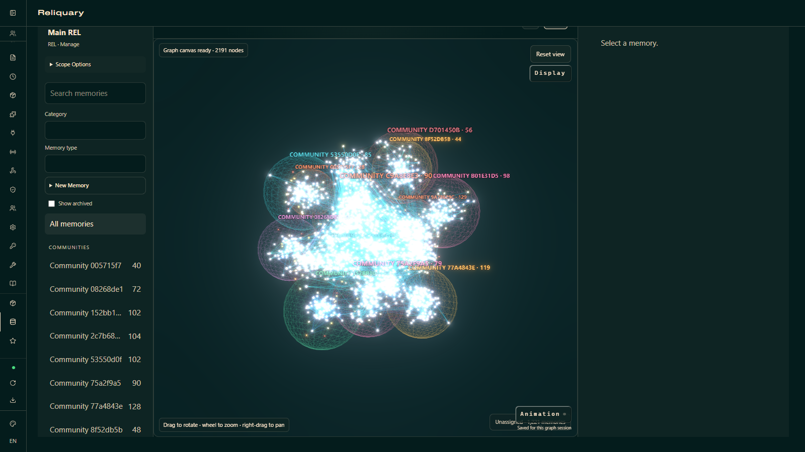

# Reliquary for Hermes

Persistent, inspectable memory for Hermes, with source provenance and a relationship-driven 3D graph. Hermes owns your conversations; Reliquary keeps the permitted copies and the Memories derived from them in local REL files. Your selected PHY supplies a read-only identity layer.

[Watch the 86-second narrated demo](assets/reliquary-demo-86s.mp4). The graph footage uses a real 2,191-node REL. Recall scenes are visibly labelled **imported-memory preview**: that imported corpus lacks the provenance needed for normal production recall. The recording demonstrates the UI and memory-search workflow; it is not an acceptance test of this catalog release's recall configuration.

## Purpose

- Recall relevant Memories automatically or through `memory_query`, `refine_query`, and `traverse_graph` in Hermes' memory toolset.
- Browse, search, inspect, edit, and connect Memories in the web dashboard. Explore communities as regions within one relationship graph, with bounded loading, display controls, animation, and saved views.
- Capture eligible new conversations after enrollment, or explicitly review and import selected existing sessions. Preserve source identity and synchronize committed deletes and rewinds.
- Keep General and dedicated project REL routing separate when Hermes provides trusted project attribution.

## Overview and installation

Reliquary requires **Hermes 0.23.0 or later**. The catalog checkout includes the four Linux and macOS executables. On those platforms, Reliquary selects the executable for the Hermes backend and removes the three unused bundled executables after the first successful native start. The initial checkout downloads all four, and Git retains the original objects.

1. On Linux or macOS, run `hermes plugins install reliquary` or install from the Hermes Desktop catalog. For a manual installation, unpack the matching native release bundle into the active Hermes profile's `plugins/` directory. [Platform installation](docs/local-service.md#platform-installation)
2. On Windows, install the matching source package or catalog entry. From the installed plugin directory, run `powershell -ExecutionPolicy Bypass -File scripts/build-native.ps1` with a Rust toolchain, Cargo, and Visual Studio C++ build tools installed. The script builds the locked source and stages `host/reliquary-hermes-host.exe`. The attested Windows host artifact is also available for manual installation. [Native host workflow](.github/workflows/native.yml)
3. Open Reliquary's **Setup** tab in the web dashboard, or run `hermes memory setup reliquary`. Select or create your General REL and active PHY, review the selected files, and connect. Setup provisions a random profile-scoped local service token through Hermes' credential API.
4. Use a compatible Hermes build containing `ctx.llm.embed/aembed` ([Hermes PR #154202](https://github.com/NousResearch/hermes-agent/pull/154202)), then select an embedding model in Hermes's **Configure auxiliary models → Embedding** picker. Hermes's existing provider authentication supplies ordinary processing and recall inference. Enable the Hermes `memory` toolset for explicit recall.

The **Native host** GitHub Actions workflow builds and tests each package on its target OS. Verify the released archive's SHA-256 or GitHub build attestation before unpacking it. GitHub release bundles can be installed manually. Catalog updates follow the reviewed catalog SHA.

### Hermes-owned inference

The active profile's `ctx.llm` supplies structured completion for ordinary processing and recall decisions, and embeddings for query and document vectors. Hermes owns provider and model selection, credentials, refresh, and authentication. Reliquary setup selects owner files. An optional profile setting enables Perception's native Jev decisions using an existing Hermes-scoped credential. [Perception route setup](docs/local-service.md#perception-decision-route)

The embedding API prerequisite is audited at Hermes commit `168a923023a7018be3dbf66530531dd20b1834b9`. Earlier builds report `embedding_unavailable`; browsing remains available. Initial embedding support covers compatible API-key routes, including selected custom/OpenRouter shared-space models. Chat-only OAuth grants such as Codex do not authorize embeddings. Select and authenticate compatible models through Hermes's own settings.

Prior routes JSON, `processing.json`, `reliquary.cfg`, and any old plugin provider-key setting remain untouched and inactive. No raw provider credentials are passed to the native host. Failure in Hermes produces an unavailable/retryable status without a credential fallback. `RELIQUARY_HERMES_TOKEN` remains private local-service transport authentication, provisioned during setup. Standalone Reliquary retains its CVCFG/key lifecycle. Changes to embedding model, dimensions, input handling, or normalization require the existing vector compatibility/reprocessing workflow.

### Compatibility

The web dashboard supports setup and writes after Hermes admits the active profile and browser origin. Stock Desktop supports browsing; setup and writes enable only when Hermes forwards verified native admission. Desktop graph rendering additionally needs Hermes' bounded byte-transport SDK capability. List and the Memory inspector remain available when it is absent. See the [host capability evidence](docs/verification.md#hu06-stock-and-fixed-hermes-acceptance).

Project-specific routing and automatic source capture are capability-gated. Hosts without trusted project attribution use General memory for new sessions. Hosts without the trusted history contract pause automatic capture. Imported Memories without accepted source provenance may be visible in the dashboard while production recall refuses them.

## Data and process disclosure

- **Files:** reads and writes the explicitly selected REL files, reads the selected PHY, and maintains owner configuration, source copies, queue/recovery data, graph caches, and service coordination files under the active Hermes profile's `reliquary` directory. It does not query Hermes' transcript database directly; permitted history comes through Hermes APIs. The private inference broker has no durable plaintext prompt cache.
- **Processes and local network:** launches `reliquary-hermes-host` (`reliquary-hermes-host.exe` on Windows) with `--state-dir <profile directory>` as a long-running background process. It binds authenticated HTTP to `127.0.0.1` on an ephemeral port. Setup may launch the same host for validation or creation, or a transient Python/Tk native file chooser on Windows. Native builds run Cargo/Rust and access their package registries. No shell is launched for agent tools.
- **Provider network:** Processing, retrieval, and optional Perception send bounded queries, source excerpts, and Memory content through the profile's authenticated inference routes and can incur provider charges. A dedicated profile-bound worker services the signed local broker while no chat turn is active. Readiness probes use synthetic text only. The native child receives only the local service token through stdin; it receives no model-provider credentials.
- **Lifecycle:** the service shares one profile's owner leases and persists queued source copies. A committed delete tombstones the copy and a rewind retracts the affected suffix. Archive and restore keep the copied knowledge available. See [recovery and backups](docs/local-service.md).
- **Telemetry:** the plugin includes no telemetry or usage reporting. Hermes' own opt-in metrics are controlled by Hermes.

## Development and verification

`npm --prefix dashboard ci` followed by `npm --prefix dashboard run check` checks and builds both UI entries. Python checks use `PYTEST_DISABLE_PLUGIN_AUTOLOAD=1`, `PYTHONDONTWRITEBYTECODE=1`, and `python -B -m pytest -q --basetemp .pytest_tmp`; set `HP01_HERMES_CHECKOUT` to the audited Hermes checkout for lifecycle probes. Native checks use `cargo test --manifest-path host/Cargo.toml --locked -j 1`.

Validate the exact release checkout with `hermes plugins validate <plugin-directory> --install-deps`. The catalog declares the lifecycle hook; memory tools are supplied through the selected MemoryProvider interface rather than generic `register_tool` registrations. The package uses public provider, hook, dashboard, and Desktop SDK extension surfaces. Private compatibility imports are reviewed as validator warnings; it does not replace Hermes functions or modify its core UI.

## Related docs

- [Documentation index](docs/INDEX.md)
- [Local service, security, and recovery](docs/local-service.md)
- [Protocol and authority](docs/protocol.md)
- [Pinned Hermes audit](docs/host-audit.md)
- [Verification and remaining gates](docs/verification.md)

## Notes

Maintained by [Lokee86](https://github.com/Lokee86). The [Reliquary project](https://github.com/Lokee86/Reliquary) owns the storage/runtime model. Source-only native distribution and host capability limits are deliberate constraints of this initial submission.
